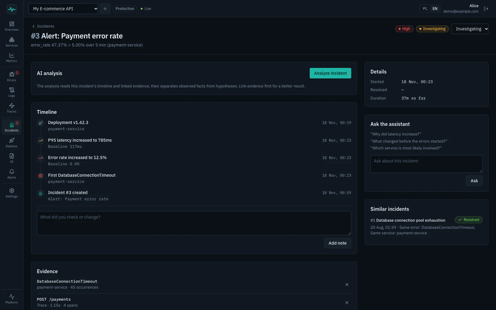
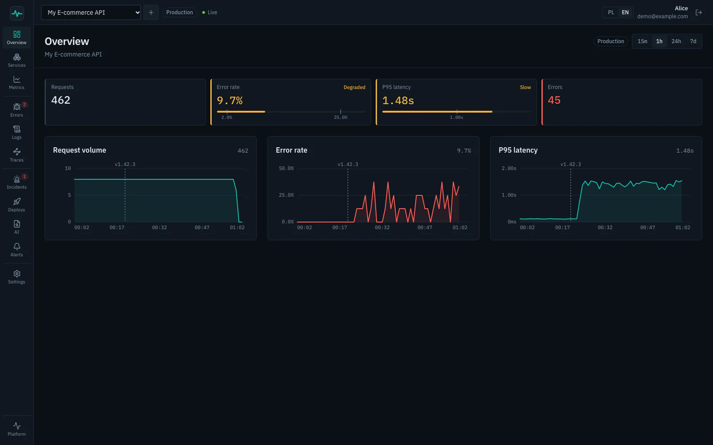
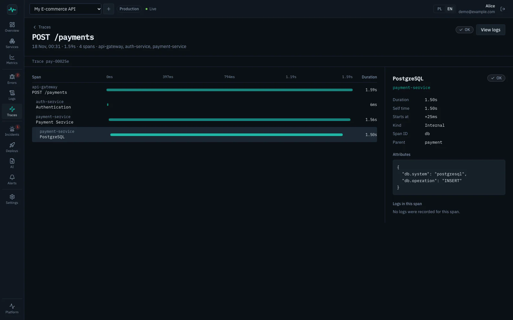
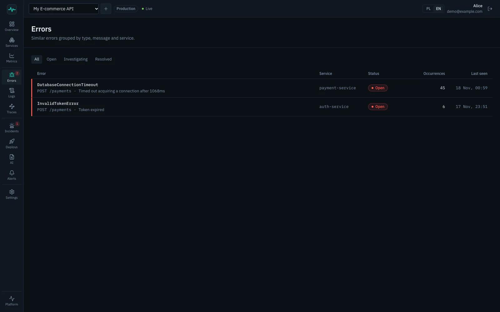
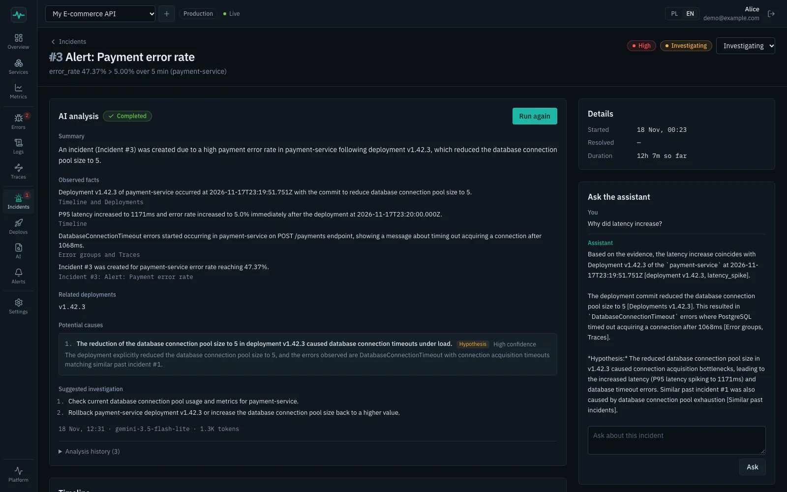
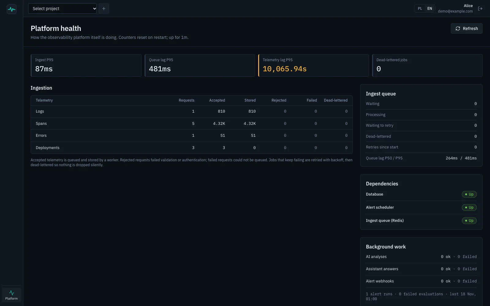
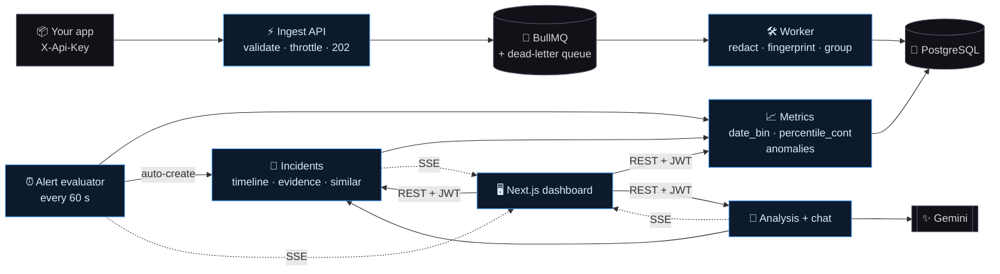

<p align="center">
  
</p>

<p align="center">
  <a href="https://github.com/MaksZiem/ai-observability/actions/workflows/ci.yml"></a>
  
  
  
  
  
  
  
  
  
  
</p>

<p align="center">
  <a href="#-highlights">Highlights</a> ·
  <a href="#-screenshots">Screenshots</a> ·
  <a href="#-architecture">Architecture</a> ·
  <a href="#-quick-start">Quick start</a> ·
  <a href="portfolio/PORTFOLIO.en.md">Full case study</a>
</p>

---

> **Not "a log viewer with a chatbot".** Apps send **logs, spans, errors and deployments** to an ingestion API. The platform stores, groups and correlates them, detects anomalies, and when something breaks it builds an **incident timeline** automatically. Gemini then analyzes **curated, structured evidence** and must keep *observed facts* apart from *hypotheses*.

<p align="center">
  
</p>

## ✨ Highlights

<table>
  <tr>
    <td width="50%" valign="top">
      <h3>📥 Ingestion that never loses data</h3>
      <code>POST /ingest/{logs,spans,errors,deployments}</code> returns <code>202</code> immediately. A BullMQ worker persists batches with 8 retries and exponential backoff, then a <b>dead-letter queue</b>.
    </td>
    <td width="50%" valign="top">
      <h3>🔗 One correlated data model</h3>
      <b>errors → traces → logs → service → deployment</b>, linked by <code>traceId</code>, <code>spanId</code>, <code>requestId</code> and time. Trace waterfalls, grouped errors and charts with deployment markers.
    </td>
  </tr>
  <tr>
    <td width="50%" valign="top">
      <h3>🧠 Evidence-based AI analysis</h3>
      A bounded, redacted <code>&lt;evidence&gt;</code> block goes to Gemini in JSON mode. The Zod-validated result separates <b>facts with evidence</b> from <b>hypotheses with a confidence level</b>. The follow-up chat cites its sources, e.g. <code>[deployment v1.42.3]</code>.
    </td>
    <td width="50%" valign="top">
      <h3>📈 Anomalies and alerts</h3>
      Baseline-aware detection of latency and error-rate spikes is placed on the timeline. Alert rules on <code>error_rate</code>, <code>p95_latency</code> or <code>request_count</code> can create incidents or call SSRF-safe webhooks.
    </td>
  </tr>
  <tr>
    <td width="50%" valign="top">
      <h3>🧩 Smart error grouping</h3>
      Fingerprint = service + type + a normalized message (UUIDs, hex values and numbers removed), so <i>"timed out after 5000ms"</i> and <i>"…5012ms"</i> become one issue. Similar past incidents are found with an explainable weighted Jaccard.
    </td>
    <td width="50%" valign="top">
      <h3>🛡️ Secret redaction</h3>
      Passwords, tokens, JWTs, <code>Bearer</code> headers, API keys and Luhn-valid card numbers are masked <b>before</b> storage. Telemetry is treated as untrusted input, which also guards against prompt injection.
    </td>
  </tr>
</table>

## 📸 Screenshots

<table>
  <tr>
    <td width="50%"></td>
    <td width="50%"></td>
  </tr>
  <tr>
    <td align="center"><sub><b>Overview</b>: requests, error rate and P95 with deployment markers</sub></td>
    <td align="center"><sub><b>Trace waterfall</b> with the slow PostgreSQL span highlighted</sub></td>
  </tr>
  <tr>
    <td width="50%"></td>
    <td width="50%"></td>
  </tr>
  <tr>
    <td align="center"><sub><b>Grouped errors</b> with occurrences, first and last seen</sub></td>
    <td align="center"><sub><b>AI analysis</b>: facts, hypotheses, suggested investigation</sub></td>
  </tr>
  <tr>
    <td colspan="2"></td>
  </tr>
  <tr>
    <td colspan="2" align="center"><sub><b>Platform self-monitoring</b>: ingest latency, queue depth, retries, dead-lettered batches</sub></td>
  </tr>
</table>

## 🏗️ Architecture



The **ingest path** and the **query path** are separate: ingestion only authenticates, validates and enqueues. The worker reuses the same domain services as the rest of the app, so the public ingest contract did not change when the queue was introduced.

<details>
<summary><b>🎬 The demo scenario: from a bad deploy to an AI analysis</b></summary>

<br>

`npm run demo` simulates 3 hours of traffic for `api` and `payment-service`:

1. 🚀 Deployment `v1.42.3` *"Reduce database connection pool size to 5"*.
2. 🐢 4 minutes later, PostgreSQL spans slow down and ~35% of `POST /payments` fail with `DatabaseConnectionTimeout`.
3. 📊 The overview shows error rate and P95 jumping right after the deployment marker.
4. 🚨 An alert rule opens an incident, and its timeline reads *deploy → latency anomaly → error-rate anomaly → new error*.
5. 🔍 **Similar incidents** surfaces an older *"Database connection pool exhaustion"* incident.
6. 🧠 The AI analysis names the pool reduction as a **high-confidence hypothesis**, not a confirmed cause.

</details>

## 🧰 Tech stack

| | |
|---|---|
| **Frontend** | Next.js 16 (App Router) · React 19 · Tailwind CSS v4 · hand-built SVG charts · Server-Sent Events |
| **Backend** | NestJS 12 (ESM) · TypeORM · BullMQ · `@nestjs/schedule` · `@nestjs/throttler` · Zod |
| **Data** | PostgreSQL (`jsonb`, composite indexes, SQL time-series aggregates) · Redis |
| **AI** | Google Gemini in JSON mode, behind a swappable `AnalysisModel` |
| **Security** | argon2 · JWT · SHA-256 hashed API keys · secret redaction · SSRF guard · rate limits |
| **Quality** | Vitest unit tests + e2e against a real Postgres, both in GitHub Actions CI · oxlint · Prettier · Swagger at `/api/docs` |

## 🚀 Quick start

Requirements: **Node.js**, **PostgreSQL**, **Redis** and a **Gemini API key**.

```bash
# backend → http://localhost:3001/api  (Swagger: /api/docs)
cd backend
cp .env.example .env      # DATABASE_URL, REDIS_URL, JWT_SECRET, GEMINI_API_KEY, GEMINI_MODEL
npm install
npm run migration:run
npm run start:dev
npm run demo              # demo user, project, 3 h of telemetry and an incident

# frontend → http://localhost:3000   (demo@example.com / demo-password)
cd ../frontend
npm install
npm run dev
```

**Sending telemetry** from any app:

```bash
curl -X POST http://localhost:3001/api/ingest/errors \
  -H "X-Api-Key: obs_…" -H "Content-Type: application/json" \
  -d '{"errors":[{"service":"payment-service","type":"DatabaseConnectionTimeout",
       "message":"Timed out acquiring a connection after 5000ms","endpoint":"POST /payments"}]}'
# → 202 {"accepted":1}
```

## 📁 Project structure

```text
ai-observability/
├── backend/              NestJS API + ingest worker
│   ├── src/
│   │   ├── ingest/       controller, queue, worker, dead-letter queue
│   │   ├── logs/  traces/  errors/  deployments/  metrics/
│   │   ├── incidents/    timeline, evidence, similar incidents
│   │   ├── analysis/     Gemini analysis + investigation chat
│   │   ├── alerts/       rules, evaluator, webhooks
│   │   ├── realtime/     SSE stream per project
│   │   └── platform/     self-monitoring
│   └── scripts/demo.ts   demo data seeder
├── frontend/             Next.js dashboard
└── portfolio/            case study (EN/PL) and screenshots
```

## 🗺️ Roadmap

- [ ] OTLP/HTTP ingestion, so apps can connect through OpenTelemetry auto-instrumentation
- [ ] Retention policy and downsampling (ClickHouse / Timescale at higher volume)
- [ ] Slack and PagerDuty notifications
- [ ] SLOs, uptime checks, AI-generated postmortems

## 📖 Read more

The full case study covers the problem, the data model, the API, the demo run step by step, key decisions and trade-offs, and what I learned: **[English](portfolio/PORTFOLIO.en.md)** · **[Polski](portfolio/PORTFOLIO.pl.md)**.

---

<p align="center">
  <sub>Built by <a href="https://github.com/MaksZiem"><b>Maksymilian Ziembicki</b></a> · Full-stack developer</sub>
</p>
